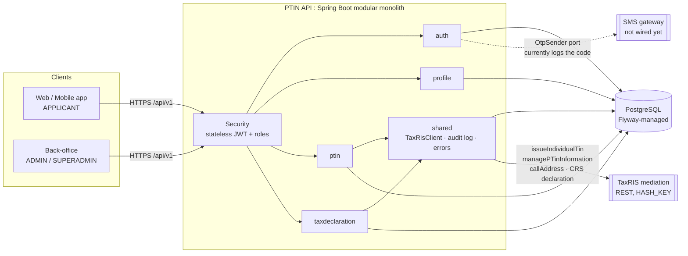
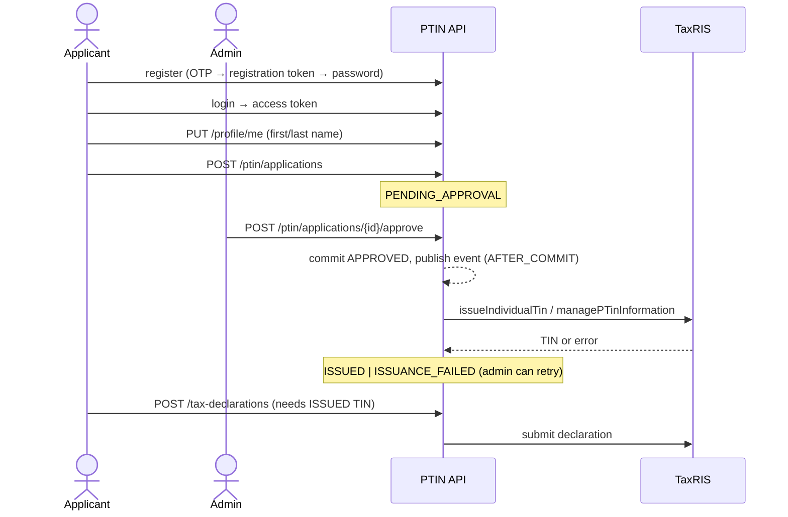

# PTIN API

Backend for the Personal Taxpayer Identification Number (PTIN) service of the Lao Ministry of Finance.
Citizens self-register, apply for a PTIN, and staff review the application; on approval the API calls the
external **TaxRIS** tax system to issue the TIN. Once a TIN is issued, the taxpayer can declare tax
(invoice/sales declarations), which are forwarded to TaxRIS as well.

Java 21 · Spring Boot 4.1 · PostgreSQL · Flyway · JWT · Gradle (wrapper only).

## Overview



### Journey



PTIN application states: `PENDING_APPROVAL → APPROVED → ISSUED | ISSUANCE_FAILED (retry)`, or
`PENDING_APPROVAL → REJECTED`. `ISSUED` and `REJECTED` are terminal.

## Features

- **Registration & login**: OTP-verified registration, password login by mobile number, TIN (once issued) or
  staff username; BCrypt passwords, lockout after repeated failures (423), password-strength hint.
- **Forgot password** via OTP; admin-issued **temporary password** as a support fallback (forces a change on
  next login).
- **OTP safety**: hashed codes, TTL, attempt ceiling, resend cooldown and per-window rate limit.
- **Profile**: auto-created on registration; must be complete before applying; admins can edit any user's.
- **PTIN applications**: `INDIVIDUAL` or `LABOR` (needs `laboId`); one application per user; admin
  approve / reject / retry / edit / search (paged).
- **TaxRIS issuance** with retry on failure, and a full **audit trail of every outbound call**
  (`GET /api/v1/admin/taxris-logs`, `HASH_KEY` redacted).
- **Tax declarations**: invoice-level declarations by taxpayers with an issued TIN, forwarded to TaxRIS.
- **Roles**: `APPLICANT`, `ADMIN`, `SUPERADMIN` (inherits `ADMIN`).
- Uniform `ApiResponse<T>` envelope and consistent HTTP error mapping.

### Endpoints (base `/api/v1`)

| Group | Endpoints |
|---|---|
| `auth` | `POST register/otp/request`, `register/otp/verify`, `register/complete`, `login/password`, `forgot-password/otp/request`, `forgot-password/otp/verify`, `forgot-password/reset`, `password`; `GET me` |
| `profile` | `GET/PUT me`; `PUT users/{userId}` (admin) |
| `ptin/applications` | `POST` submit; `GET` mine / `{id}`; admin: `GET search`, `PUT {id}`, `POST {id}/approve`, `{id}/reject`, `{id}/retry` |
| `tax-declarations` | `POST`, `GET`, `GET {id}` (own) |
| `admin` | `POST users/temporary-password`; `GET taxris-logs` |

PTIN issuance lifecycle: [docs/ptin-issuance-lifecycle.md](docs/ptin-issuance-lifecycle.md). Full request/response reference: [docs/api-integration.md](docs/api-integration.md) and
[docs/auth-api-integration.md](docs/auth-api-integration.md). TaxRIS contract: [docs/taxris/taxris_guide.md](docs/taxris/taxris_guide.md).

## System design

### Architecture

DDD **modular monolith**; each bounded context is internally **hexagonal** (ports & adapters):

```
com.example.ptin.<module>/
  domain/         model · exception · event · port/in (use cases) · port/out (repos, gateways)   ← pure Java
  application/    usecase/ package-private @Service classes
  infrastructure/ rest · persistence · acl · event · otp · client ...                             ← adapters
```

| Module | Responsibility |
|---|---|
| `auth` | users, OTP challenges, registration / login / reset flows, JWT issuance |
| `profile` | per-user name/avatar; completeness rule |
| `ptin` | PTIN application aggregate, approval workflow, TaxRIS issuance coordination |
| `taxdeclaration` | tax declarations and their submission to TaxRIS |
| `shared` | `TaxRisClient` + call log, JWT/security config, `ApiResponse`, exception handler, JPA auditing |

### Boundaries

- **Module boundary**: a module never touches another module's `application` or `infrastructure`. It calls
  the other's `domain.port.in` interface only, via either
  - **domain events** (`UserRegisteredEvent` → `profile` creates an empty profile;
    `PtinApplicationApprovedEvent` → TaxRIS issuance), consumed with
    `@TransactionalEventListener(AFTER_COMMIT)`, or
  - **anti-corruption adapters** in `infrastructure/acl` (e.g. `auth`'s `PtinTinLookupAdapter` → `ptin`'s
    `FindIssuedTinUseCase`).
- **Trust boundary (public)**: only `/auth/register/**`, `/auth/login/**`, `/auth/forgot-password/**` and
  `/actuator/health` are unauthenticated. Everything else needs `Authorization: Bearer <JWT>`. Admin-only
  actions are gated with `@PreAuthorize("hasRole('ADMIN')")` on application services, not controllers.
- **External boundary**: TaxRIS is reached only through `shared/mediation/TaxRisClient`; clients never talk
  to it. Calls are audited in `taxris_api_call_logs`. The SMS gateway sits behind the `OtpSender` port.
- **Data boundary**: PostgreSQL schema is owned by Flyway (`ddl-auto: validate`).

### Key design decisions

- **Auth as state machines**: an OTP is exchanged for a short-lived signed *flow token*
  (`REGISTRATION` / `PASSWORD_RESET`) that alone unlocks the last step; access and flow tokens cannot
  substitute for each other. Nothing durable is created until `register/complete`.
- **Failed-attempt counters commit in their own transaction** (`REQUIRES_NEW`, row locked `FOR UPDATE`;
  gateways return an outcome enum rather than throw) so a rolled-back failed attempt still counts.
- **No DB transaction across outbound HTTP**: approval commits first; the AFTER_COMMIT listener then calls
  TaxRIS and persists the result through a separate `REQUIRES_NEW` gateway bean.
- **Domain-generated UUID IDs**, soft delete (`deleted_at`), JPA auditing (`created_*`/`updated_*`).
- **Stateless security**: no sessions, no CSRF. JWTs are *not* revoked on password change; they expire
  (24 h default).

### Data model (Flyway `V1`–`V8`)

`users` · `otp_challenges` · `profiles` · `ptins` (applications) · `tax_declarations` ·
`taxris_api_call_logs` (plus legacy `external_api_call_logs`).

## Getting started

Prerequisites: JDK 21 (Gradle toolchain), Docker.

```bash
docker-compose up -d                         # PostgreSQL on localhost:5433 (db/user/password: ptin)
./gradlew bootRun                            # API on :8080; Flyway creates the schema
psql -h localhost -p 5433 -U ptin -f scripts/init-db.sql   # seed staff: superadmin / admin
./gradlew test                               # tests (context test needs the DB above)
```

### Configuration

Env-var placeholders in `application.yaml` with dev defaults; `application-uat.yaml` / `application-prod.yaml`
only change behavior. **Secrets always come from the environment, never from profile files.**

| Variable | Purpose |
|---|---|
| `PTIN_DB_URL`, `PTIN_DB_USERNAME`, `PTIN_DB_PASSWORD` | PostgreSQL |
| `PTIN_JWT_SECRET`, `PTIN_JWT_EXPIRY_SECONDS`, `PTIN_JWT_ISSUER` | JWT signing / lifetime |
| `PTIN_MEDIATION_BASE_URL`, `PTIN_MEDIATION_HASH_KEY`, `PTIN_MEDIATION_SYS` | TaxRIS mediation |

`otp.expose-in-response` echoes the OTP in the response message (on by default and in UAT, **off in prod**).
OTP and lockout policy live under `otp.*` and `auth.password.*`.

### Docker & deployment

```bash
./scripts/docker-build-debug.sh   # ptin:debug
./scripts/docker-build-uat.sh     # ptin:uat
./scripts/docker-build-prod.sh    # ptin:prod
./scripts/deploy-uat.sh           # build + deploy to the UAT server over VPN
```

Multi-stage image (Gradle build → `eclipse-temurin:21-jre`), layered jar, non-root user,
`-XX:MaxRAMPercentage=75`.

### API collections

- `bruno/` — one request per endpoint: `cd bruno && bru run --env uat --env-var password=<admin pw>`
- `bruno-e2e/` — new-user end-to-end flow (register → approve → TIN issued):
  `cd bruno-e2e && bru run new-user-flow --env uat --env-var adminPassword=<admin pw>`.
  Needs `otp.expose-in-response=true` and calls the real TaxRIS — **never run against prod**.
  Also holds negative-path folders (`auth-negative`, `lockout-and-reset`, `admin-permissions`,
  `ptin-reject-and-negative`, `tax-declaration-negative`, `labor-flow`); see `CLAUDE.md` for what each covers.
- `postman/` — Postman collection.

## Known limitations

- OTP delivery is a logging placeholder; no real SMS gateway yet.
- Access tokens are not revocable before expiry.
- One PTIN application per user is enforced in code only (no DB unique constraint); many-per-user is planned, see [docs/ptin-issuance-lifecycle.md](docs/ptin-issuance-lifecycle.md#6-remarks--todo).
- No test coverage beyond a few domain tests and the context-load test.

## Contributing notes

Keep `README.md`, `CLAUDE.md` and `docs/api-integration.md` in sync with any behavior, endpoint, config or
schema change (and `docs/taxris/taxris_guide.md` for TaxRIS changes).
