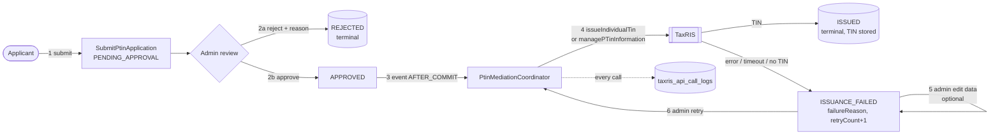
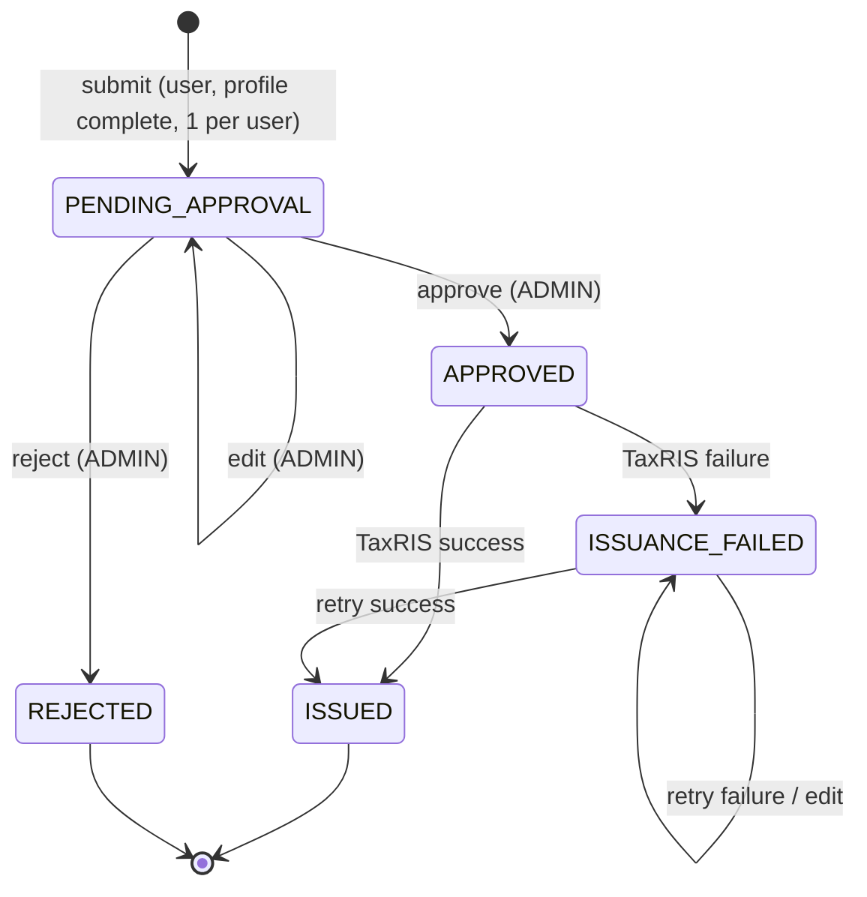
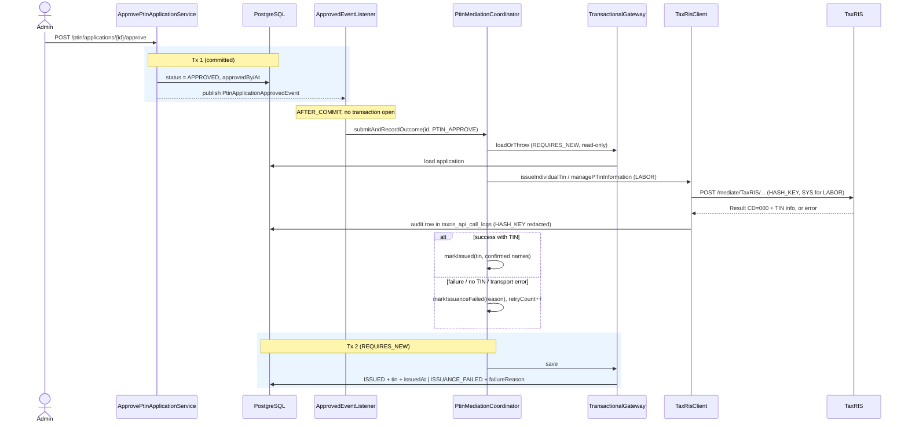

# PTIN Issuance Lifecycle

How a PTIN application goes from submission to an issued TIN. Code lives in the `ptin` module
(`com.example.ptin.ptin`) and calls TaxRIS through `shared/mediation/TaxRisClient`.

## 1. Overview

## 2. State machine

| Transition | Trigger | Guard (else 409) |
|---|---|---|
| submit | `POST /ptin/applications` | profile complete (422); user has no application yet (409); `LABOR` needs `laboId` (400) |
| approve / reject | `POST /{id}/approve`, `/{id}/reject` (ADMIN) | status is `PENDING_APPROVAL` |
| edit | `PUT /{id}` (ADMIN) | status is `PENDING_APPROVAL` or `ISSUANCE_FAILED` |
| issue / fail | automatic after approve, or retry | status is `APPROVED` or `ISSUANCE_FAILED` |
| retry | `POST /{id}/retry` (ADMIN) | status is `APPROVED` or `ISSUANCE_FAILED` |

`APPROVED` is transient: the issuance runs right after the approve transaction commits.

## 3. Sequence: approve → issue

Retry is the same flow from the `M->>G` step on, with function source `PTIN_RETRY` and no preceding
approve transaction (`RetryPtinIssuanceService` calls the coordinator directly).

## 4. Which TaxRIS service

| `PtinType` | TaxRIS call | Extra fields |
|---|---|---|
| `INDIVIDUAL` | `issueIndividualTin` | `HASH_KEY` |
| `LABOR` | `managePTinInformation` | `HASH_KEY`, `SYS` (default `LMIS`), `LABO_ID` |

Success means HTTP 2xx, result code `000` **and** a non-blank TIN. Anything else (non-`000`, HTTP error,
unparseable body, timeout) becomes `ISSUANCE_FAILED` with TaxRIS's message (or `TaxRIS call failed`).
On success TaxRIS's confirmed given/family name replaces the submitted ones.

## 5. Design notes

- **No DB connection across the HTTP call.** Approve commits first; the listener runs after commit; the
  coordinator is not `@Transactional`, so load → TaxRIS call → save use separate short transactions.
- **`PtinApplicationTransactionalGateway` is its own bean with `REQUIRES_NEW`.** Self-invocation would skip
  the proxy, and joining the just-committed transaction in an AFTER_COMMIT listener would never flush the write.
- **Failure is data, not an exception.** TaxRIS errors are stored on the application; the approve request
  itself still succeeds and the admin sees `ISSUANCE_FAILED`.
- **Audit and idempotency hints.** Each attempt logs one `taxris_api_call_logs` row keyed by the application id with
  `attempt_no = retryCount + 1`, function source (`PTIN_APPROVE` / `PTIN_RETRY`) and who triggered it. Read them at
  `GET /api/v1/admin/taxris-logs?referenceId=<applicationId>`.
- **Downstream effects of `ISSUED`.** The user can log in with the TIN and declare tax (`/tax-declarations`).
- **Known gap.** A process crash between Tx 1 and Tx 2 leaves the application `APPROVED`; an admin can recover
  with `retry` (allowed from `APPROVED`).

## 6. Remarks / TODO

**Current rule: one PTIN application per user (any status, rejected included).** Planned: allow many per user
in the future. Until then:

- [ ] **Race condition.** The rule is enforced only in `SubmitPtinApplicationService` (`findByUserId`). There is no
      unique constraint on `ptins.user_id` (only the plain `idx_ptins_user_id`), so two simultaneous submits can both
      pass. Option: `CREATE UNIQUE INDEX uq_ptins_user_id ON ptins (user_id) WHERE deleted_at IS NULL`, mapping the
      violation to the same 409; drop it in the migration that introduces many-per-user.
- [ ] `idx_ptins_tin` is not unique, so nothing prevents one TIN being stored on two applications.
- [ ] A rejected applicant can never reapply (by design today); decide the reapply rule for the many-per-user design.

**When moving to many PTINs per user, revisit these 1:1 assumptions:**

- [ ] `SubmitPtinApplicationService`: replace the "any application exists" check with the new rule (for example
      one *open* application at a time, or one per `PtinType`).
- [ ] `auth` → `TaxpayerTinLookupPort` / `FindIssuedTinUseCase` returns a single TIN: TIN login must resolve a TIN to
      its owner, and the user's "primary" TIN needs defining.
- [ ] `taxdeclaration` → `TaxpayerTinPort.findIssuedTin(userId)`: `DeclareTaxService` needs the caller to say which TIN
      it declares under (and check the TIN belongs to them).
- [ ] `GET /auth/me` exposes a single `tin`; becomes a list or a primary TIN.
- [ ] Update `CLAUDE.md` and `docs/api-integration.md`, which both state the one-per-user rule.
